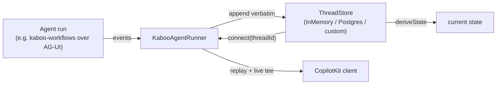

# Concepts

The architecture behind kaboo-runtime in one page.

## The event log is the source of truth

kaboo-runtime makes the **server** the custodian of conversation history. Every
AG-UI event a run emits is appended to the thread's log **in order** — messages,
tool calls, sub-agent events, state changes and the `CUSTOM` events a rich UI
needs. A finished run is compacted with AG-UI's `compactEvents`, which joins
deltas without changing what it replays to. Everything else — messages, current
state, sub-agent cards — is *derived* from that log, never stored separately.

## The three seams

| Piece | Role |
|-------|------|
| `KabooAgentRunner` | A CopilotKit `AgentRunner` that records every run and replays a thread's log on reconnect. |
| `ThreadStore` | The pluggable persistence interface — `InMemoryThreadStore`, `PostgresThreadStore`, or your own. |
| `deriveState` | Reconstructs current state from an event log (the last `STATE_SNAPSHOT` with every later `STATE_DELTA` applied), used identically by every store. |

## Replay on reconnect

`connect(threadId)` replays the thread's stored log, then tees any in-flight
run: if nothing is running it emits the stored events and completes; if a run is
in flight it emits the stored prior turns and then forwards live events. That is
what lets a browser reload — or a second tab — rebuild the full transcript and
keep watching live work.

## Server-owned history and durable approvals

kaboo-workflows writes what a turn accumulates back as a `STATE_DELTA` under
`kaboo_sessions`. Before every run, `KabooAgentRunner` derives the thread's state
and sets it on the agent as `input.state`, so every agent's transcript is seeded
from the server — the browser never carries it, or even sees it.

The same key carries a paused run waiting on the person, which is why a
question or an approval survives a workflows restart instead of failing with
`No agent session found for resume`. Which keys the browser may see or write is
set per key; see [Replay & state](replay-and-state.md#who-owns-each-state-key),
which also covers `hydrate()` after a cold start.

## The other direction: what the server sends in

State flows from the store into each run automatically. Context only the server
can vouch for — a run-scoped token, the tenant, the workflow config a run should
execute, or state the agents should read — is returned from `enrich`. See
[Server-side props](server-side-props.md).

## MCP Apps

The runner works under CopilotKit's MCP Apps support: an app's own requests
pass straight through, unrecorded, and a run whose MCP App tool the middleware
answered goes on with the agent in the same run. See
[Replay & state](replay-and-state.md#a-run-that-answered-its-own-calls).

## Where it sits in the stack

kaboo-runtime is the persistence/orchestration layer of the
[kaboo stack](https://gl-pgege.github.io/kaboo-docs/): agents authored with
[kaboo-workflows](https://gl-pgege.github.io/kaboo-workflows/) stream over
AG-UI, kaboo-runtime persists and replays that stream, and
[kaboo-react](https://gl-pgege.github.io/kaboo-react/) renders it.
